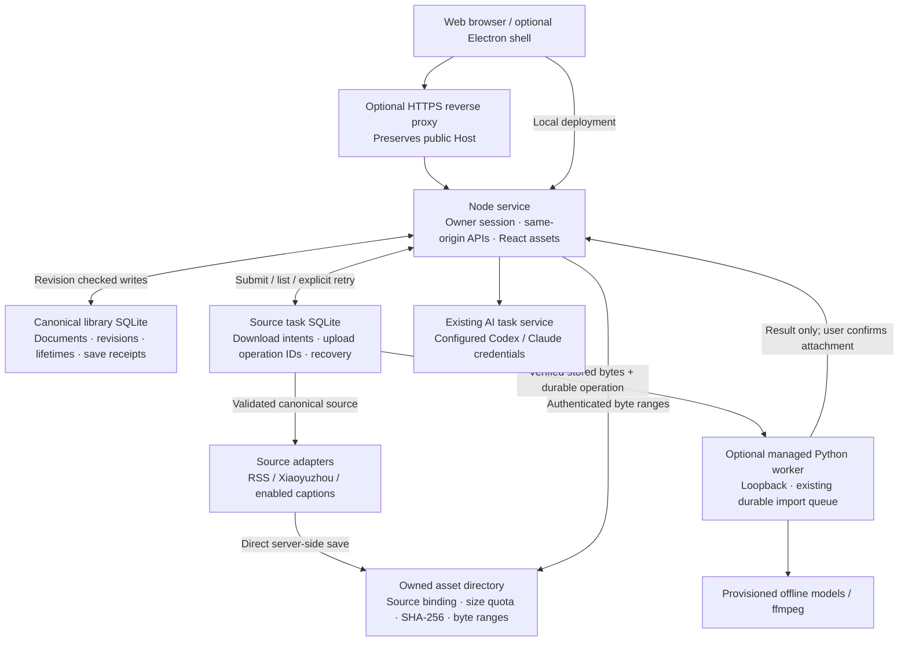

# Standalone Coconut service

The same React application and Node service run on a Mac, a private host or a
server behind HTTPS. Electron is optional. Use Node 22.21+ or 24.5+, then:

```sh
npm ci --ignore-scripts
cp .env.example .env
npm start
```

The listener defaults to `127.0.0.1:8080`. Set `COCONUT_PORT` if that port is
occupied. `COCONUT_DATA_DIRECTORY` is an absolute persistent directory, defaulting
to `~/.coconut/service`, containing `library/` and `tasks/`. This is deliberately
separate from legacy desktop/development libraries; explicitly select/copy the
intended complete library with all writers stopped. Never run two writers over
one directory or place a live SQLite database in cloud-sync/network storage.

## Browser access from other devices

Set `COCONUT_PUBLIC_ORIGIN` to the exact public HTTPS origin, without a path or
trailing slash, and `COCONUT_OWNER_TOKEN` to a private randomly generated token.
The login page exchanges the token for an HttpOnly, Secure, SameSite=Strict cookie
valid for 12 hours. The token is never stored in browser localStorage or URLs.
The same secret/origin preserves sessions over service restart; rotating the
secret invalidates existing sessions. `/login` also provides logout.

Terminate HTTPS at a reverse proxy and preserve the public Host header. Forward
to the service's private HTTP listener. Forwarded identity headers grant no
access. Requests with a rewritten localhost Host are rejected, not treated as
local privileged clients. Expose only the HTTPS proxy publicly; use `COCONUT_HOST=0.0.0.0` for a
container/private interface only with the owner profile configured. A public
listener without an HTTPS origin and owner token is rejected at startup.
Plain HTTP owner sessions are supported only on localhost/127.0.0.1 for local
use and browser tests. This is a single-owner service, not multi-user hosting.

The authenticated owner can invoke server-side source acquisition, AI and text
processing regardless of browser location, subject to configured capabilities
and the existing explicit execution consent. Provider credentials and models
belong to the serving machine. Browser-profile login and native filesystem
authorization remain local operations. Nothing installs a model or logs in to a
provider on startup.

## Source networking and trust

The service uses one source-network configuration for identified Xiaoyuzhou and
video adapters. With no explicit setting it reads validated standard proxy
environment variables when present; otherwise it uses ordinary networking,
including transparent TUN. `COCONUT_SOURCE_NETWORK=direct` ignores environment
proxies. `environment` snapshots supported proxy/NO_PROXY variables; `custom`
uses `COCONUT_SOURCE_PROXY`. The old podcast/caption proxy settings are accepted
only when unambiguous. HTTP `ALL_PROXY` aliases are normalized for Node's agent;
SOCKS settings fail startup explicitly for this service entry, rather than
silently connecting directly. Legacy video-only entrypoints retain their own
supported proxy schemes. Node's built-in proxy agents own the HTTPS tunnel; Coconut
does not implement another tunnel for this service path. macOS system HTTP/PAC
settings alone are not automatically read by standalone Node.

For identified Xiaoyuzhou HTTPS origins, the authenticated process owner trusts
the serving machine's network, including Fake-IP. Exact origins, redirect scope,
TLS validation, content types, sizes and deadlines remain enforced. This policy
does not pretend that a Fake-IP identifies the true destination address. Generic
RSS/arbitrary URLs retain the existing DNS-validated pinned-socket policy;
non-public results remain rejected. It is not safe to globally allow reserved
addresses or silently downgrade after a denied request. An untrusted multi-user
URL-fetching service needs a separately controlled/isolated egress boundary.

## Managed ASR and container deployment

Set `COCONUT_ASR_PYTHON` to an existing prepared Python executable and optionally
`COCONUT_MODEL_DIRECTORY` to the Hugging Face cache root (the directory containing
`hub/`). `npm start` then owns an internal loopback Python worker, chooses its
port, connects the existing ASR API and closes it on shutdown. A killed parent
also closes its control pipe so the worker settles its owned transcriber and
releases storage. Interrupted inference retains the existing explicit retry
contract. Do not also set `COCONUT_ASR_EXECUTOR_URL`; that setting is for a
separately managed existing worker. Neither mode installs packages or downloads
weights. Missing cached models are reported by the existing capability endpoint;
reading remains usable.

The container builds the Python dependencies and ffmpeg in the image. Provision
the existing `small` model cache separately and mount it read-only at `/models`.
No model is fetched at build or startup. In `.env`, set the public HTTPS origin,
owner token, and host model directory, then run:

```sh
docker compose up --build -d
```

The sample publishes only `127.0.0.1:8080` on the host; put your HTTPS reverse
proxy in front and preserve Host. For example, a host Caddy site can use:

```caddyfile
reader.example.com {
    reverse_proxy 127.0.0.1:8080
}
```

The named `/data` volume retains SQLite, assets, tasks and ASR work over container
replacement. Preserve the complete volume for backup with the writer stopped.
The container uses the `node` user; bind-mounted data must be privately owned by
that UID. `/healthz` is public process liveness only and exposes no library,
execution, model, path or provider details. Authenticated capability endpoints
remain the authority for reading/writing and processing availability.

## Verification

`npm run test:service` uses authored local HTTP and storage fixtures. Normal CI
also checks existing browser and actual packaged Electron lifecycle contracts.
These tests never install a model or claim public-platform availability.

## Persistent source tasks

The standalone service advertises `client.capabilities.sourceJobs`. Its React
reader submits an explicit download or transcription command to
`/api/v1/source-jobs`; accepted work is owned by the service, not the HTTP
connection or a browser's localStorage. Other legacy entries retain their
existing source/media behavior.

For podcast projects, the service reads the current canonical source descriptor,
revalidates the RSS enclosure when applicable, and saves the acquired bytes
directly in the owned asset store. Media does not round-trip through the browser.
Transcription streams a verified owned asset into the existing Python import
queue using a durable upload operation identity. This adds no second inference
queue. Stored source tasks remain discoverable by project in a fresh browser.

Source hashes, library namespace and document lifetime bind each task to its
project. Changing a source, deleting/restoring a project, or corrupting a stored
asset cannot silently attach old bytes/results. Notes and title edits retain the
same source authority. A completed transcript is only attached by an explicit
user action using the library's revision-checked save, preserving project notes
and bookmarks. Existing transcript content is not automatically replaced.

On service restart an interrupted download requires explicit retry. A lost ASR
receipt is reconciled against the original upload operation before any explicit
retry; reading status never resubmits a model job. Closing a browser does not
cancel accepted work. During an uncertain upload, cancellation waits for an
executor receipt rather than claiming a job was cancelled without evidence.
Explicitly re-fetching a completed download can repair missing/corrupt bytes.
Once a transcription operation owns the asset, different audio bytes cannot
replace it in that project; create a separate project to review a changed source.
This also closes the result-to-library-save race across browsers.
Each source task store is bounded to 256 records; existing asset size/storage
quotas remain enforced. This is a single-owner deployment with one writer.



`npm run test:service-browser` includes real Chromium, SQLite and authored WAV
coverage across independent browser contexts and service restart. Only the ASR
receipts in that browser test are simulated; it does not establish live model
quality or universal public-source access.
